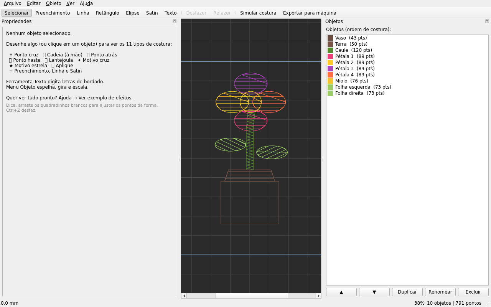
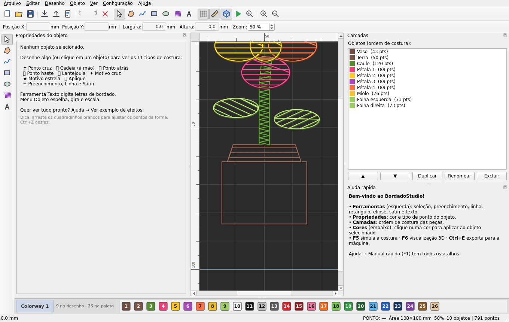
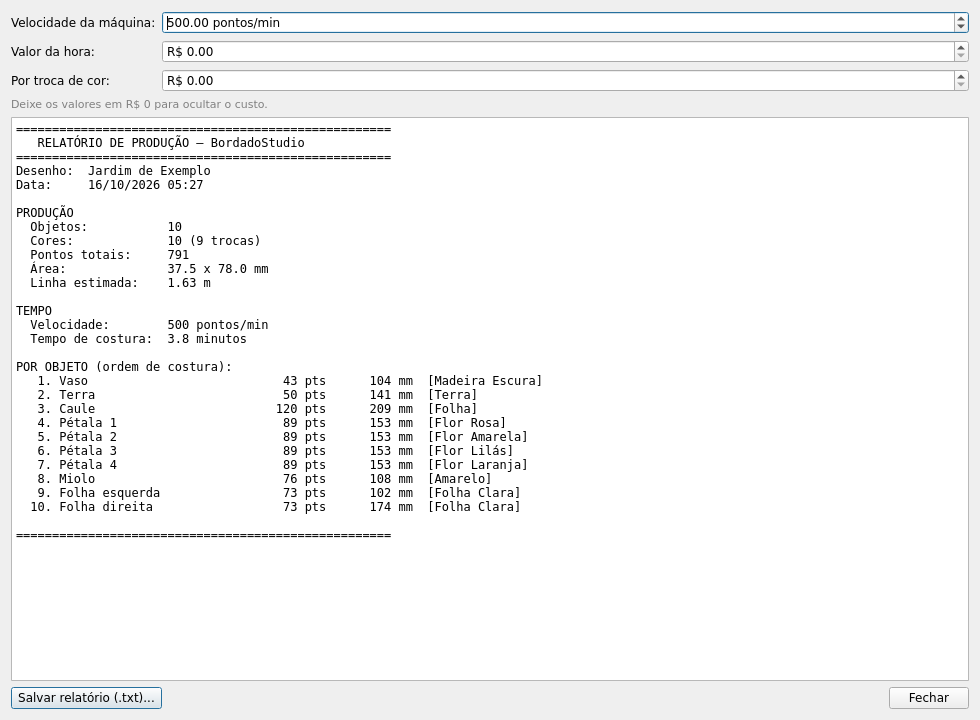

# 🧵 BordadoStudio

**Software livre de digitalização de bordado** — desenhe formas, gere pontos
automaticamente, importe e exporte arquivos para máquinas de bordar.

Criado do zero. **Sem login, sem ativação, sem assinatura, sem limitações.**
Instalou, usou.







---

## ✨ Recursos

- 🎨 **Editor de desenhos** com 6 ferramentas:
  - **Preenchimento** (tatami) — formas fechadas preenchidas com pontos
  - **Linha** — desenho livre em linha simples
  - **Retângulo** e **Elipse** — arraste para criar
  - **Satin** — colunas em zig-zag (texto, contornos, hastes)
  - 🔤 **Texto** — digite palavras em letras de bordado
- 🔤 **Módulo de Letras**: alfabeto completo (A-Z, a-z, números, pontuação
  e acentos do português: ç, ã, õ, á, é, í, ó, ú, â, ê, ô...) em 5 estilos
  (linha, satin, haste, cadeia, ponto atrás), com altura e espaçamento
- ✂️ **Transformar objetos**: espelhar (H/V), girar 90°, escalar (menu Objeto)
- ✨ **11 tipos de costura** — clique no objeto e troque em Propriedades:
  - Preenchimento (tatami), Linha simples, Bordado satin (coluna e borda)
  - ✝️ **Ponto cruz** — grade de X dentro das formas
  - ⛓️ **Cadeia** (chain) — visual de bordado à mão
  - 🪡 **Ponto atrás** — costura manual sobreposta
  - 🌿 **Ponto haste** (stem) — trança inclinada
  - ✨ **Lantejoula** — motivo circular bordado
  - ✦ Motivo cruz e ★ Motivo estrela — preenchimentos decorativos
  - 🩹 **Aplique** — posicionamento + fixação + borda (máquina)
- 🧵 **Paletas de linha** nomeadas em português + cores personalizadas
- 📐 **Propriedades ajustáveis**: espaçamento, ângulo, comprimento do ponto,
  largura e densidade do satin — com atualização imediata
- ✂️ **Edição de vértices**: arraste os quadradinhos brancos para refinar
  qualquer forma
- 💾 **Importar** arquivos DST, PES, PEC, EXP, JEF, VP3, XXX, SEW, HUS e mais
- 💽 **Exportar** para DST, PES, PEC, EXP, JEF, VP3, XXX, U01, TBF, SVG, CSV, PNG
- ▶️ **Simulação de costura** animada antes de mandar para a máquina
- 👁️ **Visualização 3D** (F6) — pontos com volume realista
- 📊 **Relatório de produção** — pontos, área, linha, tempo e custo,
  com exportação em .txt (Arquivo → Relatório de produção)
- ↩️ **Desfazer/refazer** ilimitado
- 📁 **Projetos `.bds`** — salve e continue depois
- 🔢 Barra de status com coordenadas em mm, zoom e contagem de pontos

## 🎛️ Interface profissional (v1.4)

- **Menus completos**: Arquivo, Editar, Desenho, Objeto, Ver, Configuração, Ajuda
- **Barras de ferramentas com ícones** (desenhados pelo próprio programa)
- **Paleta de ferramentas à esquerda** e painéis acopláveis: Propriedades,
  Camadas e Ajuda rápida
- **Réguas em milímetros** na área de desenho
- **Barra de informações**: posição X/Y, largura/altura do objeto e zoom
- **Barra de cores (Colorway)** embaixo: clique numa cor para aplicar ao
  objeto selecionado (ou define a cor dos próximos)
- **Barra de estado**: tipo de ponto, área do bastidor, zoom e contagem

## 🧵 Catálogo de pontos (v1.6)

**Contornos** (barra Contornos): Linha simples · Ponto duplo · Ondulado ·
Bico (scallop) · Mola · Ponto motivo · Ponto haste · Cadeia · Ponto atrás ·
Satin

**Enchimentos** (barra Enchimentos): Preenchimento (tatami) ·
Contorno concêntrico · Radial · Rede (malha) · Espiral · Tijolinho ·
Ponto cruz · Lantejoula · Motivo cruz · Motivo estrela · Aplique

**Mais itens novos:**
- Seletor de **Unidades: Métrico / Polegadas** (réguas, campos e status
  acompanham a escolha)
- Campos rápidos de **Comprimento do ponto** e **Espaçamento** na barra
  Ajustes (aplicam ao objeto selecionado)
- Exemplo pronto: `exemplos/tipos.bds` com os 21 tipos lado a lado

## 🧰 42 ferramentas e busca da máquina de bordado (v1.10)

- **42 botões funcionais na barra de ferramentas** (à esquerda, 3 colunas compactas, ícones 28 px como nos programas profissionais):
  todas as ferramentas de desenho (seleção, preenchimento, linha, retângulo,
  elipse, satin, texto), 16 formas arrastáveis (coração, estrela, losango,
  cruz, triângulo, hexágono, pentágono, octógono, seta, lua, flor, nuvem,
  arco, onda, zigue-zague e espiral), clipart, digitalizar imagem, e 17
  ações (espelhar, girar, escala, suavizar, dividir, sub-base, centralizar,
  ordem, simular, 3D, grade, réguas, exportar). **Todos fazem algo de
  verdade** — cada um é testado automaticamente.
- **Encontrar a máquina de bordado:** no painel *Exportar*, escolha ou
  **digite** o nome da sua máquina (Tajima, Brother, Janome, Pfaff,
  Husqvarna Viking, Singer, Melco, Bernina, Barudan…) — o formato certo
  (DST, PES, JEF, VP3, EXP, XXX…) é selecionado automaticamente antes de
  exportar. A busca aceita texto parcial (ex.: "brother").
- **Exportar** grava em 9 formatos de máquina + SVG/CSV/PNG de apoio.

## 🖼️ Auto-digitização de imagens e interface profissional (v1.9)

- **Digitalizar imagem (Ctrl+D):** escolha uma foto ou desenho (PNG/JPG/BMP)
  e o BordadoStudio encontra as formas, traça os contornos, mede as cores e
  converte tudo em pontos de costura — com pré-visualização, ajuste de
  limiar, suavização, área mínima, modo *Preenchimento* ou *Contorno* e
  opção de usar as cores da imagem. Tudo feito do zero, sem bibliotecas.
- **Interface no padrão profissional:** 12 menus (Arquivo, Editar,
  Visualização, Desenho, Objeto, Arranjar, Função, Ponto, Gráficos,
  Configuração, Janela, Ajuda), barras em 3 linhas (arquivo/edição,
  posição e tamanho, catálogo **Contornos** e **Enchimentos**), ferramentas
  em duas colunas à esquerda, painéis à direita em abas verticais
  (Propriedades, Lista de cor do objeto, Tecido/bastidor, Exportar),
  aba do documento, réguas, grade e barra de status em 4 blocos.
- **Novo:** imprimir (Ctrl+P), recortar/copiar/colar objetos (Ctrl+X/C/V),
  zoom 100% (Ctrl+1).

## 🌈 Mistura multi-fio, curvas e clipart (v1.8)

Três recursos novos pedido a pedido:

- **Mistura multi-fio (gradiente):** o tipo *Mistura multi-fio* mescla duas
  linhas num mesmo preenchimento, alternando as cores em fileiras (efeito
  gradiente). O botão **Mistura** escolhe a segunda cor; a exportação gera
  as trocas de cor reais da máquina (2 linhas no cabeçalho).
- **Edição de nós com curva/reta:** com o objeto selecionado aparecem os
  vértices. **Clicar com o botão direito** num vértice o exclui;
  **duplo-clique** num vértice alterna o segmento entre reta e curva
  (losango laranja = com curva); **duplo-clique** na borda entre dois
  vértices insere um novo ponto.
- **Clipart pronto (Ctrl+Shift+L):** biblioteca com 14 desenhos vetoriais
  gerados pelo próprio programa (flor, sol, lua, borboleta, peixe, raio,
  nuvem, casa, carro, avião, arco-íris, folha, árvore e pata). Escolha o
  tamanho e o desenho entra no centro da tela, pronto para costurar.

Exemplos em `exemplos/mistura.bds` e `exemplos/clipart.bds`.

## 🏁 Completude profissional (v1.7)

Comparado com os programas top de mercado, o BordadoStudio agora também tem:

- **Bastidor nomeado**: biblioteca de áreas (redondas, quadradas, retangulares,
  faixa) — o status mostra o bastidor e a tela desenha a forma certa
- **Campos de precisão**: Posição X/Y e Largura/Altura editáveis em mm (ou in)
  — digite o valor exato e o objeto vai para lá
- **Catálogos de linhas reais**: Madeira Classic, Anchor e Isacord (além das
  paletas próprias) no seletor de cores
- **Perfis** (predefinições de costura): salve um conjunto de ajustes e
  aplique com um clique (barra Ajustes → Perfil)
- **Menu Arranjar**: centralizar na área (Ctrl+Shift+C), centralizar por eixo,
  trazer para o início / enviar para o fim da ordem de costura
- **Cor do tecido**: fundo escuro, cinza, branco, jeans ou cru
  (Configuração → Cor do tecido)

## 🎛️ Botões de ação (v1.5)

- **Formas prontas** (arraste para desenhar): ❤️ Coração, ⭐ Estrela,
  ◆ Losango, ✚ Cruz, ▲ Triângulo e ⬡ Hexágono — já saem com preenchimento
- **Barra Contornos**: aplica o tipo de ponto ao objeto selecionado com um
  clique — Linha, Satin, Haste, Cadeia, Ponto atrás, Ponto cruz,
  Lantejoula e Aplique
- **Barra Ações**: Espelhar (H/V) · Girar ±90° · Girar 45° (Ctrl+G) ·
  Escalar · **Suavizar contorno** · **Dividir objeto em dois** ·
  **Ligar/desligar sub-base (underlay)**
- Exemplo pronto: `exemplos/formas.bds`

## 🖥️ Instalação (Windows)

1. **Instale o Python** (se ainda não tiver):
   - Baixe em <https://www.python.org/downloads/>
   - ⚠️ Na instalação, **marque a opção "Add Python to PATH"**

2. **Instale o BordadoStudio**:
   - Clique duas vezes em **`instalar.bat`**
   - Pronto! O instalador cria tudo automaticamente (sem login de nada).

3. **Para usar**:
   - Clique duas vezes em **`Abrir BordadoStudio.bat`** (criado pelo instalador)

## 🚀 Como usar — manual rápido

| Ferramenta | Atalho | Como funciona |
|---|---|---|
| Selecionar | `S` | Clique no objeto para mover; arraste os quadradinhos brancos para ajustar os pontos |
| Preenchimento | `P` | Clique nos vértices da forma; **duplo-clique** termina |
| Linha | `L` | Desenhe à mão livre |
| Retângulo | `R` | Arraste na tela |
| Elipse | `E` | Arraste na tela |
| Satin | `B` | Clique ao longo do centro da faixa; duplo-clique termina |
| Texto | `T` | Clique na tela e digite o texto em letras de bordado |

**Menu Objeto:** `Ctrl+H` espelha · `Ctrl+Shift+H` espelha na vertical ·
`Ctrl+R` gira 90° · `Ctrl+M` escala

**Outros atalhos:** `Ctrl+Z` desfazer · `Ctrl+Y` refazer · `Ctrl+S` salvar ·
`Ctrl+E` exportar · `Ctrl+I` importar · `F5` simular · `F6` visualização 3D ·
`F1` ajuda · `Ctrl+H` espelhar · `Ctrl+R` girar · `Ctrl+M` escalar ·
`Espaço`+arrastar move a tela · roda do mouse = zoom · `Esc` cancela ·
`Enter` termina a forma · `Backspace` remove o último ponto

### Fluxo típico

1. Desenhe (ou importe) os objetos do seu bordado
2. Ajuste cores e densidades no painel **Propriedades**
3. Veja a costura acontecer em **Simular costura** (F5)
4. **Exportar para máquina** (Ctrl+E) e copie o arquivo para o pendrive

## 📦 Formatos de arquivo

| Formato | Importar | Exportar | Observação |
|---|---|---|---|
| DST (Tajima) | ✅ | ✅ | mais compatível; não guarda cores |
| PES / PEC (Brother) | ✅ | ✅ | cores aproximadas para a paleta Brother |
| EXP (Melco) | ✅ | ✅ | não guarda cores |
| JEF (Janome) | ✅ | ✅ | cores aproximadas |
| VP3 (Pfaff) | ✅ | ✅ | guarda cores exatas |
| XXX (Singer), U01 (Barudan), TBF | ✅ | ✅ | |
| SEW, HUS, SHV e outros | ✅ | — | apenas leitura |
| SVG, PNG, CSV | — | ✅ | visualização / análise |

## 🗂️ Exemplos

A pasta `exemplos/` contém:

- `jardim.bds` / `jardim.dst` — projeto completo (flor com 10 objetos)
- `efeitos.bds` / `efeitos.dst` — **todos os 10 tipos de costura** lado a lado

Abra os `.bds` no programa para estudar como foram feitos.

## ❓ Perguntas frequentes

**O programa pede login ou chave?**
Não. O BordadoStudio não tem login, ativação nem verificação de licença.

**Posso usar comercialmente?**
Sim. O programa é seu para usar como quiser.

**Minha máquina não lê o arquivo exportado?**
Exporte em **DST** — é o formato mais compatível. Se a sua máquina usa
pendrive, copie o arquivo para a raiz do pendrive.

**Os pontos importados podem ser editados?**
Objetos importados podem ser movidos e recoloridos. Para editar a geometria,
desenhe novamente com as ferramentas (ou peça um ajuste!).

**As lantejoulas são gravadas para máquina com ejetor de lantejoula?**
Na versão atual a lantejoula é um **motivo bordado** (círculo com ponto de
fixação) — funciona em qualquer máquina de bordar. Comandos de ejetor físico
de lantejoula são específicos de cada fabricante e podem vir em versões
futuras.

## 🛠️ Desenvolvimento

```bash
python -m venv .venv
.venv\Scripts\pip install -r requirements.txt

# testes do núcleo
python -m unittest tests.test_core -v

# teste da interface (sem abrir janela)
python tests/smoke_gui.py
```

Estrutura:

```
BordadoStudio/
├── main.py               # inicia o programa
├── instalar.bat          # instalador Windows
├── requirements.txt      # dependências (PySide6, pyembroidery)
├── bordadostudio/
│   ├── app.py            # ponto de entrada
│   ├── main_window.py    # janela principal, menus, diálogos
│   ├── canvas.py         # cena de edição e ferramentas
│   ├── stitcher.py       # geração de pontos (fill, run, satin)
│   ├── model.py          # documento, objetos, desfazer
│   ├── formats_io.py     # importar/exportar formatos de máquina
│   ├── threads.py        # paletas de linha
│   ├── simulator.py      # simulação de costura
│   ├── props_panel.py    # painel de propriedades
│   └── object_list.py    # lista de objetos
├── tests/                # testes automatizados
└── exemplos/             # projeto de exemplo
```

> **Nota sobre PySide6:** usamos `PySide6>=6.6,<6.12` porque a versão 6.12.0
> possui um bug de memória no QPainterPath (corrupção ao destruir traços
> grandes). A limitação será removida quando o bug for corrigido upstream.

---

Feito com 💛 para quem quer bordar sem depender de ninguém.
